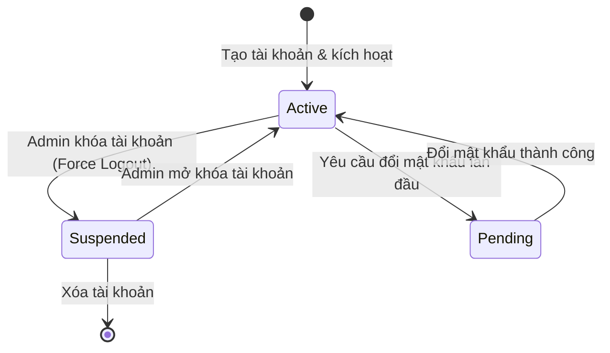
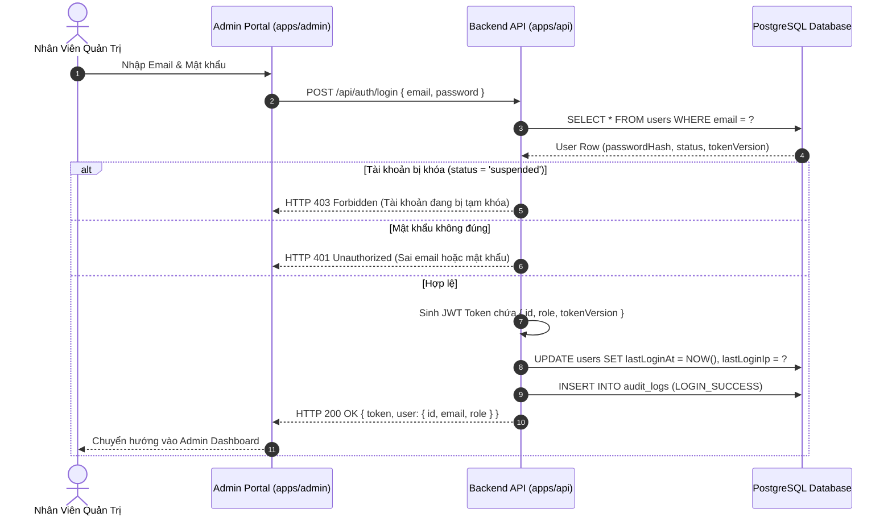
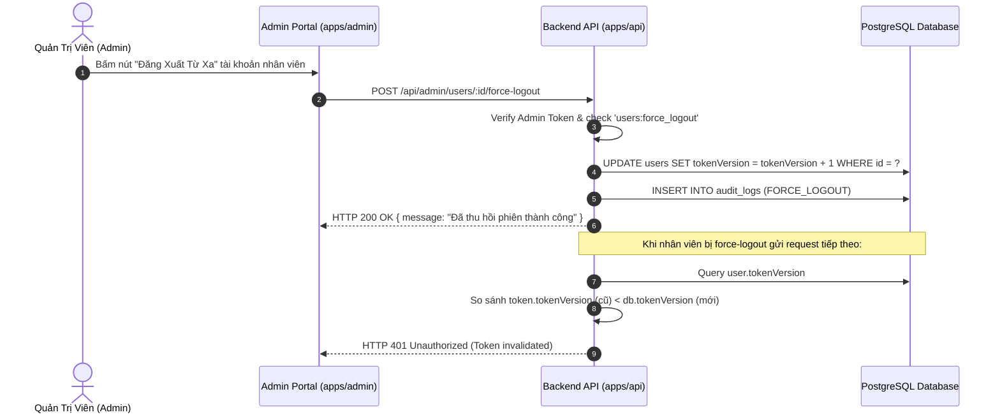

# 🔄 FLOW: Admin User & Role-Based Access Control (RBAC)

> **Module:** `admin-rbac`  
> **Tài liệu tham chiếu:** [`OVERVIEW.md`](./OVERVIEW.md), [`BACKLOG.md`](./BACKLOG.md)  

---

## 1. Sơ Đồ Trạng Thái Tài Khoản (User Status State Machine)

---

## 2. Sequence Diagram: Đăng Nhập & Thu Hồi Phiên Đăng Nhập

---

## 3. Sequence Diagram: Kiểm Tra RBAC & Thu Hồi Phiên (Force Logout)

