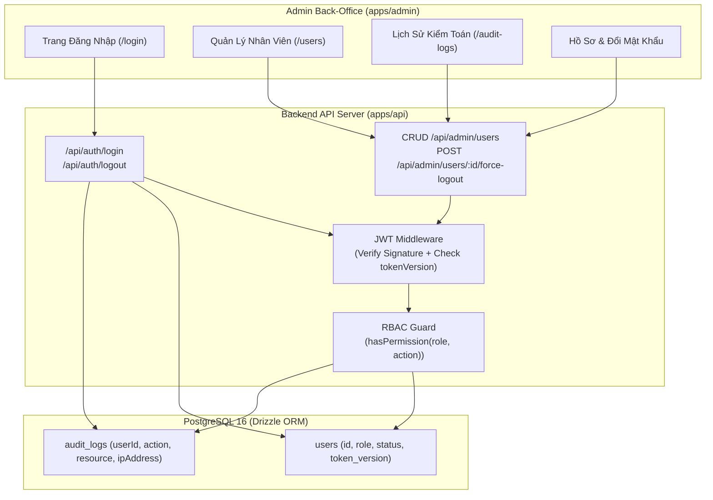

# 🛡️ Module Overview: Admin User & Role-Based Access Control (RBAC)

> **Module Slug:** `admin-rbac`  
> **Package / App Impact:** `packages/database`, `packages/types`, `apps/api`, `apps/admin`  
> **Status:** Active / Production Ready  
> **Version:** 1.0.0  

---

## 1. Mục Tiêu Nghiệp Vụ (Business Objectives)
Phân hệ **Quản Lý Người Dùng & Phân Quyền Đa Tầng (Admin RBAC)** thiết lập hàng rào an ninh cốt lõi cho toàn bộ hệ thống back-office CarDealer:
1. **Mô Hình Phân Quyền 4 Vai Trò Chuẩn Doanh Nghiệp:**
   - `admin`: Toàn quyền quản trị hệ thống, quản lý nhân viên, đổi vai trò, cấu hình hệ thống.
   - `manager`: Quản lý kho xe, bài viết, khách hàng tiềm năng, xóa yêu cầu báo giá.
   - `editor`: Biên tập và xuất bản bài viết, cập nhật thông tin dòng xe, tải ảnh thư viện.
   - `sales`: Tiếp nhận và cập nhật trạng thái leads khách hàng, xem thông số xe.
2. **Cơ Chế Thu Hồi Phiên Tức Thì (Instant Token Revocation):** Sử dụng cơ chế `tokenVersion` trên bảng `users`. Khi quản trị viên bấm "Đăng xuất từ xa" hoặc khi khóa tài khoản, `tokenVersion` tự động tăng lên $N+1$, vô hiệu hóa ngay lập tức mọi JWT token đang lưu hành trong vòng 0 giây.
3. **Nhật Ký Kiểm Toán An Ninh Bất Biến (Security Audit Trail):** Mọi hành động nhạy cảm (Đăng nhập, Đổi vai trò, Đổi mật khẩu, Khóa tài khoản, Xóa dữ liệu) đều được ghi nhận vào bảng `audit_logs` với IP, User Agent, hành động và dữ liệu chi tiết dạng append-only.

---

## 2. Lịch Sử Nâng Cấp (Evolution History)

| Phiên bản | Ngày cập nhật | Người thực hiện | Nội dung nâng cấp chính | Trạng thái |
| :---: | :---: | :---: | :--- | :---: |
| **v1.0.0** | 18/10/2026 | Security & Backend Team | Chuẩn hóa bảng `users`, `audit_logs`, tích hợp ma trận `ROLE_PERMISSIONS` cố định trong `@cardealer/types`, xây dựng API Auth & User Management | 🟢 Active |

---

## 3. Bản Đồ Thành Phần Kiến Trúc (Architecture Map)

