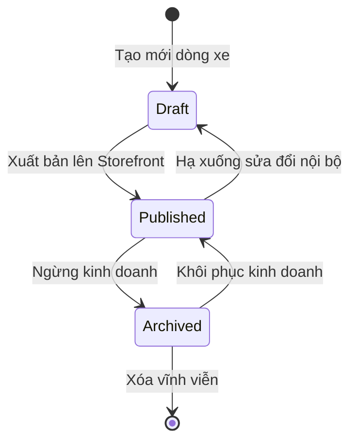
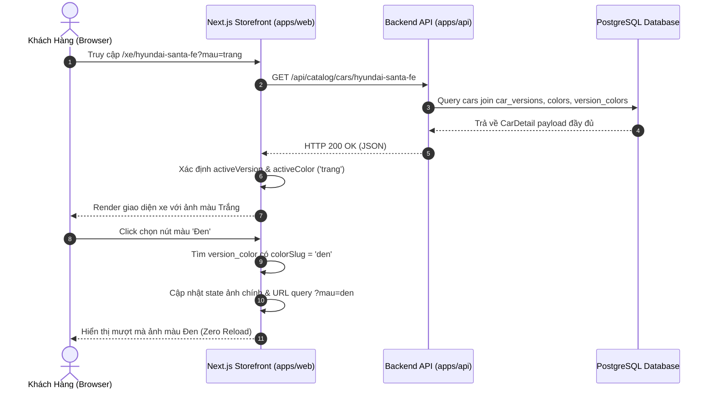
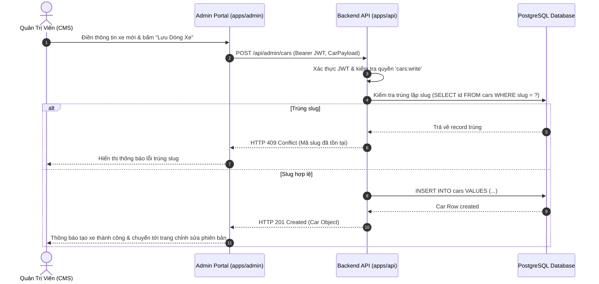

# 🔄 FLOW: Catalog & Vehicle Specification Engine

> **Module:** `catalog-management`  
> **Tài liệu tham chiếu:** [`OVERVIEW.md`](./OVERVIEW.md), [`BACKLOG.md`](./BACKLOG.md)  

---

## 1. Sơ Đồ Trạng Thái Vòng Đời Dòng Xe (Car Status State Machine)

---

## 2. Sequence Diagram: Tải Trang Chi Tiết & Chuyển Đổi Màu Sơn Ngoại Thất

---

## 3. Sequence Diagram: Quản Trị Viên Tạo Dòng Xe Mới

