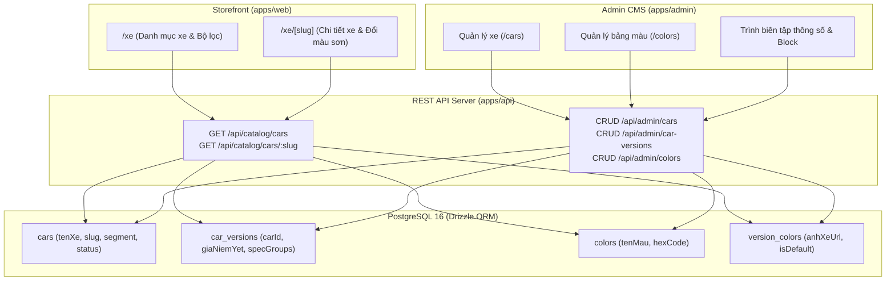

# 🚗 Module Overview: Catalog & Vehicle Specification Engine

> **Module Slug:** `catalog-management`  
> **Package / App Impact:** `packages/database`, `packages/types`, `packages/core`, `apps/api`, `apps/admin`, `apps/web`  
> **Status:** Active / Production Ready  
> **Version:** 1.0.0  

---

## 1. Mục Tiêu Nghiệp Vụ (Business Objectives)
Phân hệ **Quản Lý Danh Mục Xe & Thông Số Kỹ Thuật (Catalog Management)** là trái tim dữ liệu của toàn bộ nền tảng CarDealer Showroom, giải quyết các mục tiêu cốt lõi:
1. **Quản trị Thực thể Xe Đa Cấp (Multi-Tier Vehicle Modeling):** Quản lý dòng xe (`cars`), các phiên bản trang bị (`car_versions`), bảng màu ngoại thất trực quan (`colors`, `version_colors`) và phân khúc (`sedan`, `suv`, `mpv`, `hatchback`, `ev`).
2. **Trải nghiệm Đổi Màu Ngoại Thất Thời Gian Thực (Visual Color Switcher):** Cho phép khách hàng trên Storefront chuyển đổi màu sơn trực tiếp trên giao diện xe `/xe/[slug]` với hình ảnh độ phân giải cao và đồng bộ URL query (`?phien-ban=...&mau=...`).
3. **Quản trị Trạng thái Vòng đời Sản phẩm (Product Lifecycle State Machine):** Hỗ trợ trạng thái `draft` (biên tập nội bộ), `published` (hiển thị công khai Storefront), `archived` (ngừng kinh doanh nhưng bảo toàn liên kết SEO).
4. **Bảng So Sánh Thông Số Kỹ Thuật (Technical Spec Matrix):** Quản lý các nhóm thông số động (`specGroups`: Động cơ, Kích thước, Tiện nghi, An toàn) phục vụ người mua xe so sánh đối chiếu.

---

## 2. Lịch Sử Nâng Cấp (Evolution History)

| Phiên bản | Ngày cập nhật | Người thực hiện | Nội dung nâng cấp chính | Trạng thái |
| :---: | :---: | :---: | :--- | :---: |
| **v1.0.0** | 18/10/2026 | Fullstack Architecture Team | Chuẩn hóa toàn bộ schema Drizzle, REST API Catalog & Admin CRUD, Tích hợp Storefront `/xe` & `/xe/[slug]` với bộ chuyển màu trực quan | 🟢 Active |

---

## 3. Bản Đồ Thành Phần Kiến Trúc (Architecture Map)

