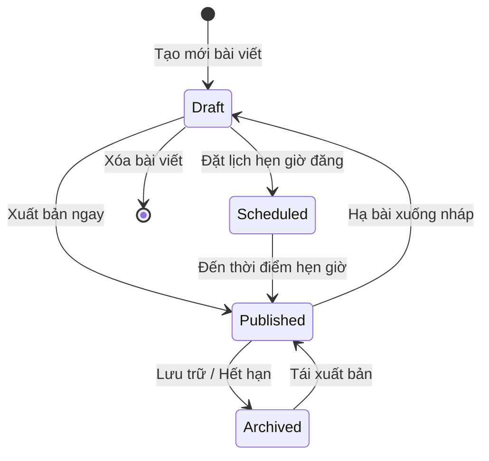
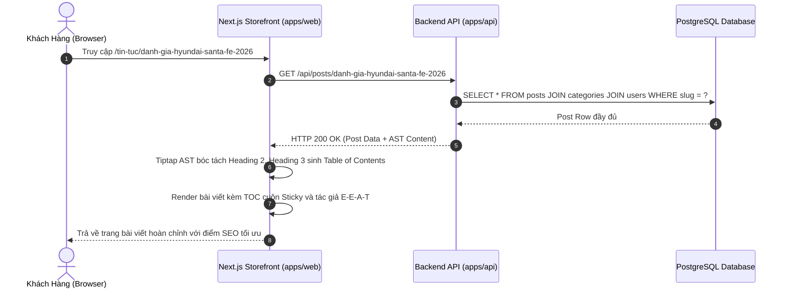
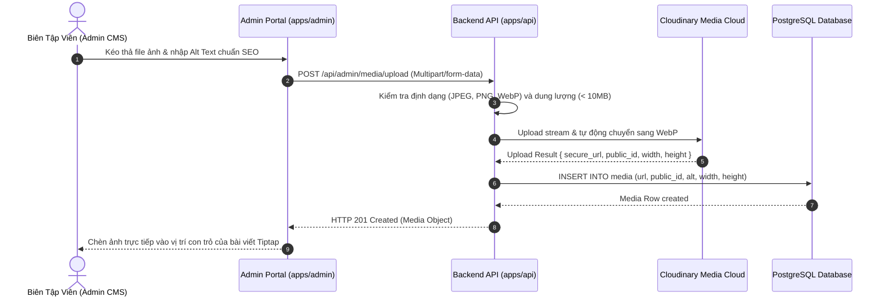
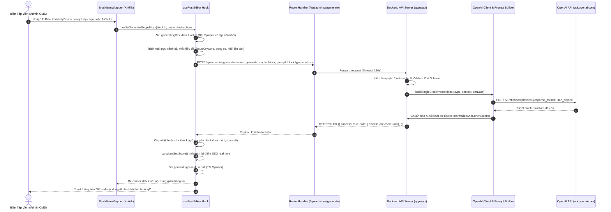
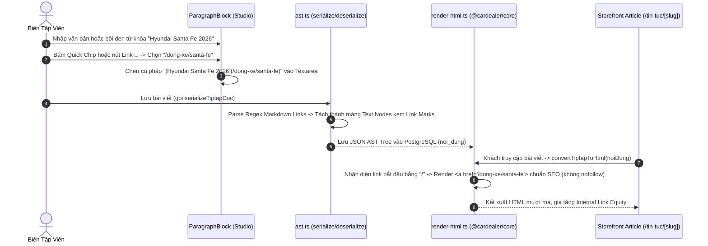
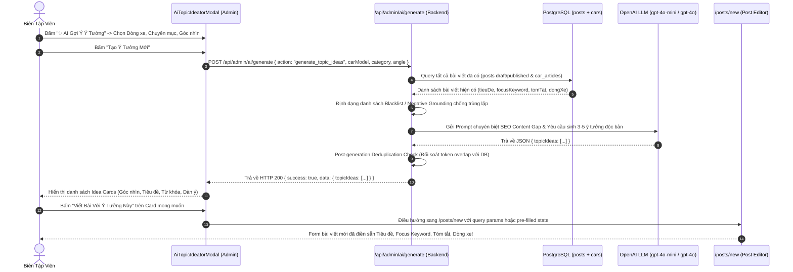

# 🔄 FLOW: Content Management & Tiptap Editorial Engine

> **Module:** `content-management`  
> **Tài liệu tham chiếu:** [`OVERVIEW.md`](./OVERVIEW.md), [`BACKLOG.md`](./BACKLOG.md)  

---

## 1. Sơ Đồ Trạng Thái Bài Viết (Post Status State Machine)

---

## 2. Sequence Diagram: Tải Trang Chi Tiết Bài Viết & Bóc Tách Mục Lục TOC

---

## 3. Sequence Diagram: Tải Ảnh Lên Cloudinary Media Library

---

## 4. Sequence Diagram: Trợ Lý AI Điền Khối Nội Dung (In-Editor Single Block Generation)

---

## 5. Sequence Diagram: Chèn & Bóc Tách Liên Kết Nội Bộ Trong Đoạn Văn Bản (Internal Links Flow)

---

## 6. Sequence Diagram: Trợ Lý AI Gợi Ý Ý Tưởng Chống Trùng Lặp (Topic Ideation Flow)

