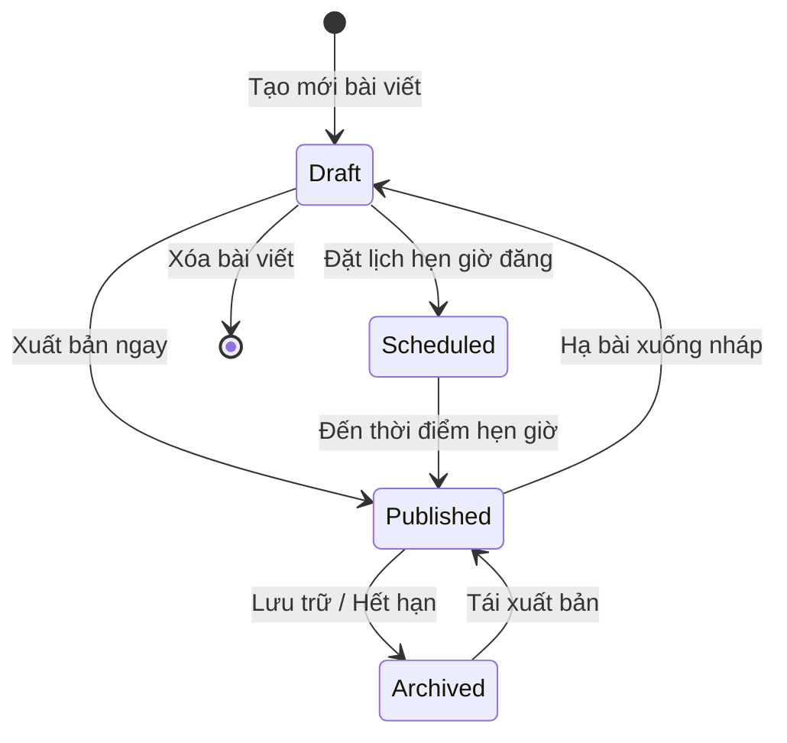
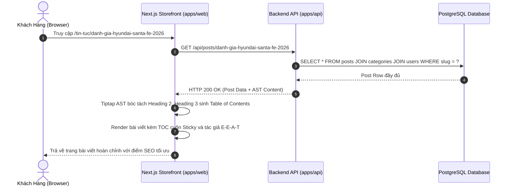
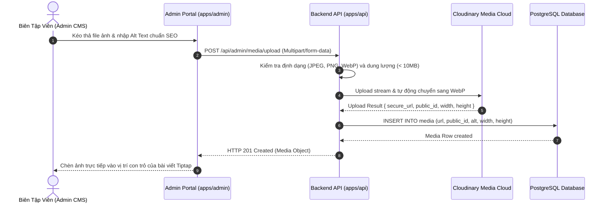

# 🔄 FLOW: Content Management & Tiptap Editorial Engine

> **Module:** `content-management`  
> **Tài liệu tham chiếu:** [`OVERVIEW.md`](./OVERVIEW.md), [`BACKLOG.md`](./BACKLOG.md)  

---

## 1. Sơ Đồ Trạng Thái Bài Viết (Post Status State Machine)

---

## 2. Sequence Diagram: Tải Trang Chi Tiết Bài Viết & Bóc Tách Mục Lục TOC

---

## 3. Sequence Diagram: Tải Ảnh Lên Cloudinary Media Library

