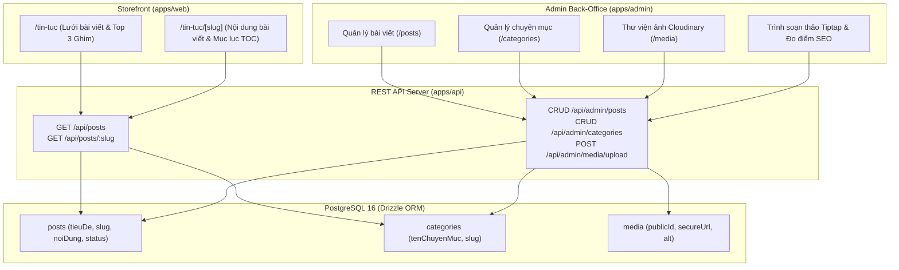

# 📰 Module Overview: Content Management & Tiptap Editorial Engine

> **Module Slug:** `content-management`  
> **Package / App Impact:** `packages/database`, `packages/types`, `packages/core`, `apps/api`, `apps/admin`, `apps/web`  
> **Status:** Active / Production Ready  
> **Version:** 1.0.0  

---

## 1. Mục Tiêu Nghiệp Vụ (Business Objectives)
Phân hệ **Quản Trị Nội Dung Bài Viết & Soạn Thảo Đa Phương Tiện (Content Management Engine)** là vũ khí Inbound Marketing và SEO trọng tâm của hệ thống CarDealer:
1. **Hệ Thống Quản Lý Tin Tức & Chuyên Mục:**
   - Quản trị các chuyên mục: Tin khuyến mãi, Bảng giá xe, Đánh giá xe, Cẩm nang hướng dẫn sử dụng.
   - Quản lý bài viết với tác giả E-E-A-T (Tư vấn viên bán hàng), thời gian đọc ước tính (`readingTime`), số đếm từ (`wordCount`).
2. **Trình Soạn Thảo Tiptap AST 8 Lean Content Blocks:**
   - Soạn thảo và hiển thị trực quan: `CalloutBlock`, `ComparisonTable`, `YouTubeEmbed`, `TikTokEmbed` (tối ưu tỷ lệ 9:16 khử thanh cuộn), `GalleryBlock`, `PriceTableBlock`, `FAQAccordion` và `RelatedCarBlock`.
3. **Thư Viện Ảnh Đám Mây Cloudinary (Media Library):**
   - Tải lên hình ảnh, gắn thẻ Alt Text chuẩn SEO, tối ưu định dạng WebP/AVIF và tích hợp Media Picker trực tiếp vào bài viết.
4. **Hệ Thống Trợ Lý Đánh Giá Điểm SEO Real-Time:**
   - Phân tích mật độ từ khóa chính (`focusKeyword`), độ dài tiêu đề H1/Meta Description, kiểm tra thẻ alt ảnh và cấu trúc H2/H3.

---

## 2. Lịch Sử Nâng Cấp (Evolution History)

| Phiên bản | Ngày cập nhật | Người thực hiện | Nội dung nâng cấp chính | Trạng thái |
| :---: | :---: | :---: | :--- | :---: |
| **v1.1.0** | 25/10/2026 | Inbound Content Team | Bổ sung Trợ lý AI Điền Khối Tức Thì (Single Block AI Generator) cho từng Content Block trong Tiptap Studio | 🟢 Active |
| **v1.0.0** | 18/10/2026 | Inbound Content Team | Xây dựng schema `posts`, `categories`, `media`, tích hợp Tiptap AST Engine, Tối ưu Storefront `/tin-tuc` và `/tin-tuc/[slug]` | 🟢 Active |

---

## 3. Bản Đồ Thành Phần Kiến Trúc (Architecture Map)

