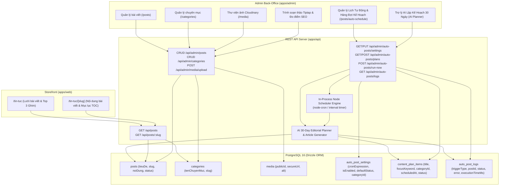

# 📰 Module Overview: Content Management & Tiptap Editorial Engine

> **Module Slug:** `content-management`  
> **Package / App Impact:** `packages/database`, `packages/types`, `packages/core`, `apps/api`, `apps/admin`, `apps/web`  
> **Status:** 🟢 Active / Production Ready  
> **Version:** 1.4.0  

---

## 1. Mục Tiêu Nghiệp Vụ (Business Objectives)
Phân hệ **Quản Trị Nội Dung Bài Viết & Soạn Thảo Đa Phương Tiện (Content Management Engine)** là vũ khí Inbound Marketing và SEO trọng tâm của hệ thống CarDealer:
1. **Hệ Thống Quản Lý Tin Tức & Chuyên Mục:**
   - Quản trị các chuyên mục: Tin khuyến mãi, Bảng giá xe, Đánh giá xe, Cẩm nang hướng dẫn sử dụng.
   - Quản lý bài viết với tác giả E-E-A-T (Tư vấn viên bán hàng), thời gian đọc ước tính (`readingTime`), số đếm từ (`wordCount`).
2. **Trình Soạn Thảo Tiptap AST 8 Lean Content Blocks:**
   - Soạn thảo và hiển thị trực quan: `CalloutBlock`, `ComparisonTable`, `YouTubeEmbed`, `TikTokEmbed` (tối ưu tỷ lệ 9:16 khử thanh cuộn), `GalleryBlock`, `PriceTableBlock`, `FAQAccordion` và `RelatedCarBlock`.
3. **Thư Viện Ảnh Đám Mây Cloudinary (Media Library):**
   - Tải lên hình ảnh, gắn thẻ Alt Text chuẩn SEO, tối ưu định dạng WebP/AVIF và tích hợp Media Picker trực tiếp vào bài viết.
4. **Hệ Thống Trợ Lý Đánh Giá Điểm SEO Real-Time:**
   - Phân tích mật độ từ khóa chính (`focusKeyword`), độ dài tiêu đề H1/Meta Description, kiểm tra thẻ alt ảnh và cấu trúc H2/H3.
5. **Trợ Lý AI Gợi Ý Ý Tưởng Bài Viết Chống Trùng Lặp (AI Topic Ideation & Deduplication):**
   - Tự động quét cơ sở dữ liệu các bài viết đã có (cả draft và published) để tìm ra các "khoảng trống nội dung" (Content Gaps), gợi ý các chủ đề và từ khóa độc bản mới lạ, phòng chống triệt để tình trạng ăn thịt từ khóa (Keyword Cannibalization).
6. **Hệ Thống Tự Động Viết Bài Theo Định Kỳ & AI Content Planner 30 Ngày (Auto Publishing Scheduler & AI Planner):**
   - Lập lịch tự động viết và xuất bản bài viết theo chu kỳ thời gian (In-Process Scheduler kết hợp API kích hoạt tức thì "Chạy ngay").
   - Trợ lý AI Phân tích & Lập Kế hoạch Biên tập 30 ngày (30-Day AI Editorial Planner): Tự động phân tích kho bài viết hiện có và dòng xe trong showroom, đề xuất kế hoạch các bài viết dự kiến cho 1 tháng (tiêu đề, từ khóa, chuyên mục, ngày giờ xuất bản mục tiêu) và đưa vào hàng đợi (`content_plan_items`).
   - Động cơ tự động sinh bài viết hoàn chỉnh (Full Article Generator Pipeline): Tự động tạo trọn vẹn từ Tiêu đề, Slug, Tóm tắt, Từ khóa SEO, Meta Description đến các khối nội dung Tiptap AST phong phú (Paragraph, Heading, Callout, FAQ, PriceTable...).
   - Cấu hình linh hoạt trạng thái xuất bản (`draft` chờ kiểm duyệt hoặc `published` tự động xuất bản ngay) và ghi nhật ký thực thi (`auto_post_logs`) chi tiết.

---

## 2. Lịch Sử Nâng Cấp (Evolution History)

| Phiên bản | Ngày cập nhật | Người thực hiện | Nội dung nâng cấp chính | Trạng thái |
| :---: | :---: | :---: | :--- | :---: |
| **v1.4.0** | 04/11/2026 | Inbound Content Team | Bổ sung Hệ thống Tự Động Viết Bài Theo Định Kỳ (In-Process Scheduler) & Trợ lý AI Lập Kế Hoạch Nội Dung 30 Ngày (AI Content Editorial Planner) | 🟢 Active |
| **v1.3.0** | 26/10/2026 | Inbound Content Team | Bổ sung Trợ lý AI Gợi Ý Ý Tưởng Bài Viết Độc Nhất Chống Trùng Lặp (AI Topic Ideation & Deduplication Engine) | 🟢 Active |
| **v1.2.0** | 26/10/2026 | Inbound Content Team | Bổ sung tính năng Gắn Link Nội Bộ (Internal Links Engine) cho các khối Đoạn văn bản (ParagraphBlock) trong Tiptap Studio | 🟢 Active |
| **v1.1.0** | 25/10/2026 | Inbound Content Team | Bổ sung Trợ lý AI Điền Khối Tức Thì (Single Block AI Generator) cho từng Content Block trong Tiptap Studio | 🟢 Active |
| **v1.0.0** | 18/10/2026 | Inbound Content Team | Xây dựng schema `posts`, `categories`, `media`, tích hợp Tiptap AST Engine, Tối ưu Storefront `/tin-tuc` và `/tin-tuc/[slug]` | 🟢 Active |

---

## 3. Bản Đồ Thành Phần Kiến Trúc (Architecture Map)

