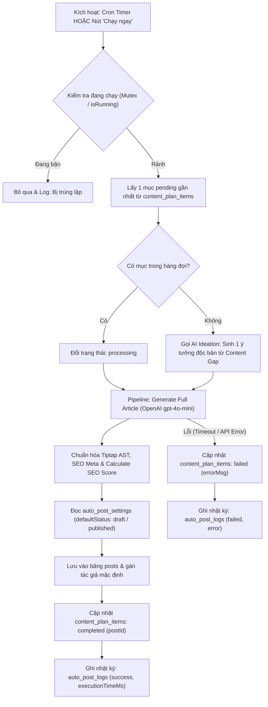

# 📐 SOLUTION OPTIONS: Scheduled Auto-Posting & AI Editorial Planner (v1.4.0)

> **Module:** `content-management`  
> **Căn cứ:** [`OVERVIEW.md`](./OVERVIEW.md), [`BACKLOG.md`](./BACKLOG.md)  
> **Tác giả:** system-analyst-architect  
> **Trạng thái:** 🟢 Approved by Developer Decision (Pure Sandbox / In-Process Cron / Admin Configurable Draft-Published)  

---

## 1. Bối Cảnh & Mục Tiêu Kỹ Thuật
Hệ thống cần cung cấp khả năng:
1. Lập lịch tự động viết và xuất bản bài viết theo chu kỳ (ví dụ 8:00 sáng hàng ngày).
2. Trợ lý AI phân tích kho nội dung hiện tại và danh mục xe trong showroom, đề xuất kế hoạch biên tập nội dung 30 ngày (Editorial Calendar Plan), sau đó nạp hàng loạt vào hàng đợi (`content_plan_items`).
3. Động cơ tự động sinh bài viết hoàn chỉnh (Full Article Generator Pipeline): tạo slug, tiêu đề, tóm tắt, từ khóa SEO, meta tags và danh sách Content Blocks Tiptap AST chất lượng cao.
4. Quản lý trạng thái xuất bản linh hoạt (`draft` hoặc `published`), cung cấp nút kích hoạt tức thì ("Chạy ngay"), và lưu nhật ký thực thi (`auto_post_logs`).

---

## 2. So Sánh Các Phương Án Kiến Trúc Scheduler (Arch Evaluation)

### Phương Án A: In-Process Node Scheduler (`node-cron` trong `apps/api`) [LỰA CHỌN ĐƯỢC CHỌN]
* **Mô tả:** Tích hợp thư viện `node-cron` trực tiếp trong vòng đời tiến trình Fastify/NodeJS của `apps/api`. Khi server khởi động, service nạp cấu hình từ database (`auto_post_settings`) và đăng ký cron task. Khi admin cập nhật cấu hình qua API hoặc bấm "Chạy ngay", service reload lại job trong memory ngay lập tức.
* **Ưu điểm:**
  - Không cần thêm hạ tầng bên thứ ba (không cần Redis server hay Worker tách biệt).
  - Tận dụng 100% database pool, Drizzle ORM và AI Service hiện có của `apps/api`.
  - Dễ triển khai, kiểm thử cục bộ và hoàn toàn phù hợp với môi trường hiện tại của dự án.
  - Hỗ trợ API trigger thủ công tức thì ("Chạy ngay") dùng chung một hàm xử lý cốt lõi.
* **Nhược điểm & Biện pháp khắc phục:**
  - Nếu scale nhiều instance API, có thể chạy trùng cron $\rightarrow$ **Khắc phục:** Dùng cờ `isProcessing` trong memory và atomic update trạng thái `processing` trong database với lock optimistic / skip locked để bảo đảm tính duy nhất (idempotency).

---

### Phương Án B: Hàng Đợi Phân Tán BullMQ + Redis Worker
* **Mô tả:** Sử dụng Redis làm message broker, `apps/api` đẩy repeatable job vào Redis queue, một worker process độc lập lắng nghe và xử lý.
* **Ưu điểm:** Khả năng mở rộng cao cho hệ thống đa server, retry phân tán tốt.
* **Nhược điểm:** Phức tạp hóa hạ tầng quá mức (cần cài đặt và duy trì Redis daemon), tốn tài nguyên bộ nhớ cho dự án xe hơi vừa và nhỏ.

---

### Phương Án C: Webhook / REST Cron Trigger Ngoại Vi
* **Mô tả:** Không chạy cron trong tiến trình NodeJS, chỉ mở endpoint `POST /api/admin/auto-posts/cron-trigger` bảo vệ bằng secret key và nhờ cron hệ điều hành (crontab) hoặc Vercel Cron gọi vào.
* **Ưu điểm:** Không chiếm bộ nhớ thường trực cho cron timer trong app.
* **Nhược điểm:** Phụ thuộc cấu hình mạng và dịch vụ ngoài, khó debug khi offline, không chủ động reload lịch khi admin đổi giờ trên giao diện.

---

## 3. Kiến Trúc Pipeline Sinh Bài Viết Tự Động (AI Generation Pipeline)

### Luồng Xử Lý Cốt Lõi (Execution Core):

---

## 4. Quyết Định Thiết Kế Cuối Cùng
1. **Engine Lập Lịch:** Sử dụng `node-cron` tích hợp trong `apps/api/src/services/auto-post-scheduler.service.ts`.
2. **Database:** Bổ sung 3 bảng trong Drizzle:
   - `auto_post_settings`: Cấu hình toàn cục (cronExpression, isEnabled, defaultStatus, categoryId, defaultAuthorId).
   - `content_plan_items`: Hàng đợi kế hoạch biên tập 30 ngày.
   - `auto_post_logs`: Lưu vết lịch sử chạy, thời gian thực thi, kết quả, lỗi.
3. **AI Service:** Bổ sung Action `generate_editorial_plan` (30-day plan) và tái sử dụng action `generate_full_article` với negative grounding.
