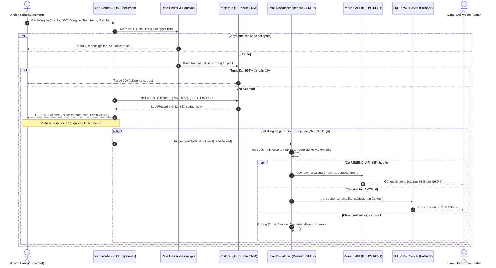
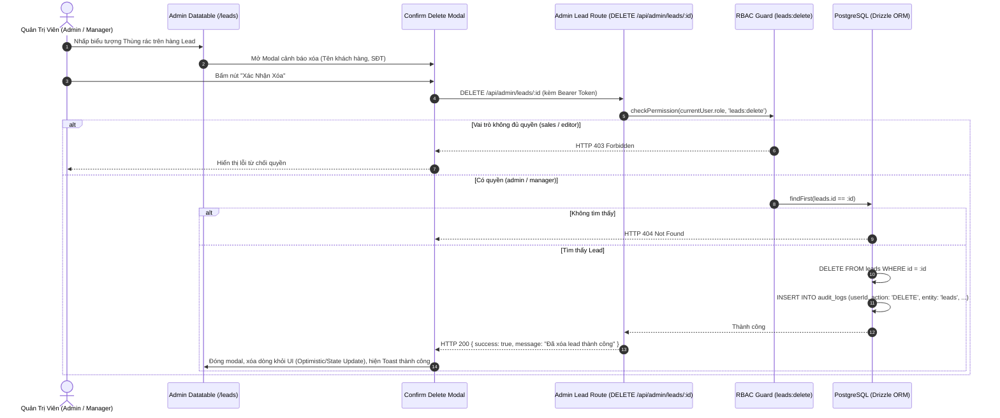

# 🔄 Logic Flow: Lead Management & Notification Engine

> **Module Slug:** `lead-management`  
> **Status:** Living Document  
> **Author:** Logic Flow BA

---

## 1. Sequence Diagram: Tiếp Nhận Lead & Gửi Email Tức Thì (US-02)

---

## 2. Sequence Diagram: Quản Trị Viên Xóa Lead (US-01)

