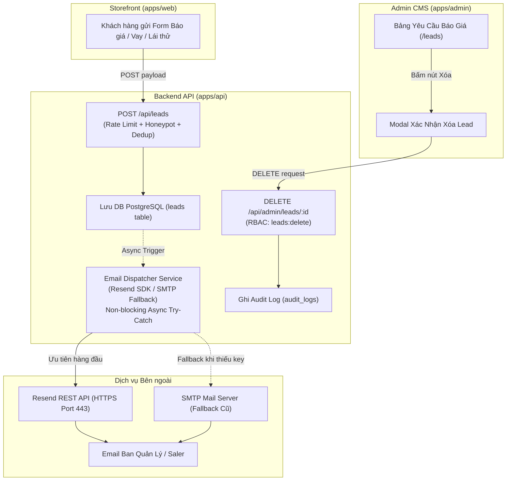

# 🚗 Module Overview: Lead Management & Notification Engine

> **Module Slug:** `lead-management`  
> **Package / App Impact:** `packages/types`, `packages/database`, `packages/env`, `apps/api`, `apps/admin`  
> **Status:** Active / Living Document  
> **Version:** 1.0.0

---

## 1. Mục Tiêu Nghiệp Vụ (Business Objectives)
Phân hệ **Quản Lý Lead & Thông Báo Tức Thì (Lead Management & Notification Engine)** giải quyết hai nhu cầu cấp thiết trong quy trình vận hành Showroom ô tô Hyundai:
1. **Quản trị Dữ liệu Lead Tinh Gọn (Lead Data Hygiene):** Cho phép Quản trị viên (Admin/Manager) xóa các yêu cầu báo giá thử nghiệm, hồ sơ vay rác hoặc số điện thoại ảo trực tiếp từ Admin CRM Datatable kèm xác nhận an toàn và ghi nhận Audit Log.
2. **Thông Báo Chốt Khách Tức Thì Qua Email (Instant Lead Email Dispatcher):** Khi khách hàng gửi yêu cầu tư vấn, tính giá lăn bánh, trả góp ngân hàng hoặc đăng ký lái thử từ bất kỳ form nào trên Storefront, hệ thống tự động gửi email thông báo chi tiết đến hòm thư Showroom/Saler để kịp thời gọi điện tư vấn trong vòng 5 phút (Golden 5-Minute Window).

---

## 2. Lịch Sử Nâng Cấp (Upgrade History)

| Phiên bản | Ngày cập nhật | Người thực hiện | Nội dung nâng cấp chính | Trạng thái |
| :---: | :---: | :---: | :--- | :---: |
| **v1.1.0** | 18/10/2026 | Auto-Pilot Agent | Refactor Email Dispatcher sang **Resend SDK** (HTTPS API) với cơ chế Fallback SMTP & Simulated Mode | 🟢 Active |
| **v1.0.0** | 18/10/2026 | Auto-Pilot Agent | Khởi tạo tính năng Xóa Lead (RBAC `leads:delete`) và Email Notification Engine qua SMTP/Nodemailer | ⚪ Archived |

---

## 3. Bản Đồ Thành Phần Kiến Trúc (Architecture Map)

