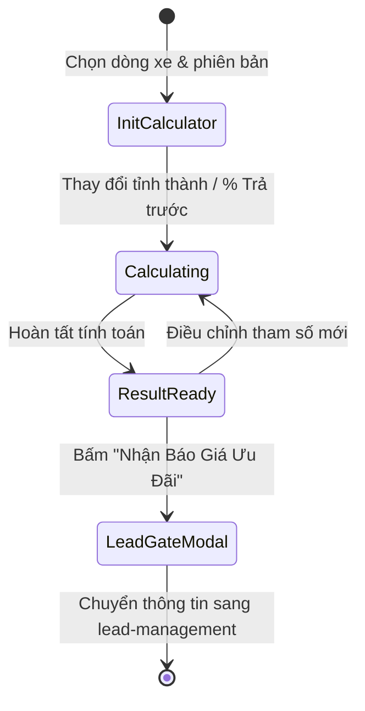
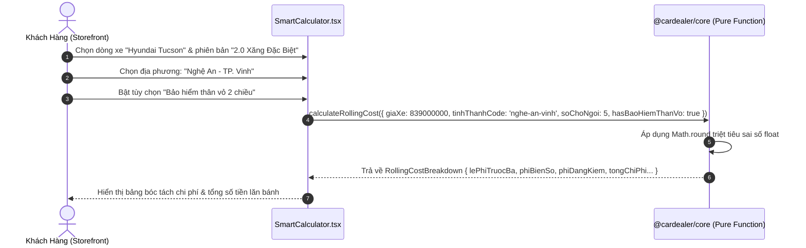
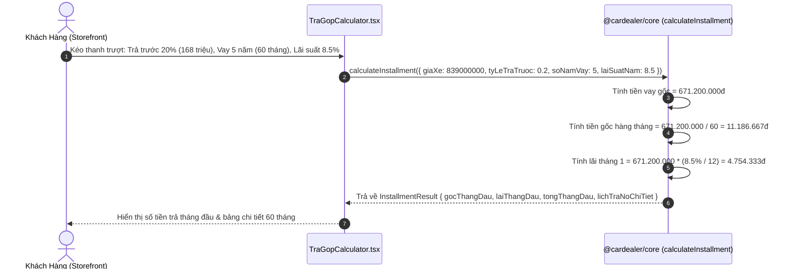

# 🔄 FLOW: Financial & Pricing Engine

> **Module:** `pricing-calculator`  
> **Tài liệu tham chiếu:** [`OVERVIEW.md`](./OVERVIEW.md), [`BACKLOG.md`](./BACKLOG.md)  

---

## 1. Sơ Đồ Trạng Thái Luồng Tính Toán (Calculator Flow State Machine)

---

## 2. Sequence Diagram: Luồng Tính Phí Lăn Bánh Client-Side (Zero Latency)

---

## 3. Sequence Diagram: Tính Lịch Trả Góp Ngân Hàng Hàng Tháng

