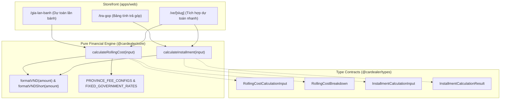

# 💰 Module Overview: Financial & Pricing Engine

> **Module Slug:** `pricing-calculator`  
> **Package / App Impact:** `packages/core`, `packages/types`, `apps/web`, `apps/api`  
> **Status:** Active / Production Ready  
> **Version:** 1.0.0  

---

## 1. Mục Tiêu Nghiệp Vụ (Business Objectives)
Phân hệ **Bộ Tính Giá Lăn Bánh & Dự Toán Trả Góp Ngân Hàng (Pricing & Financial Engine)** là công cụ thu hút khách hàng tiềm năng mạnh nhất trên Storefront:
1. **Thuật Toán Tính Chi Phí Lăn Bánh Chính Xác Địa Phương:**
   - Tự động bóc tách 6 khoản thuế phí nhà nước theo từng địa phương (TP. Vinh, Các huyện Nghệ An, Hà Tĩnh, Hà Nội, TP.HCM):
     - Lệ phí trước bạ (10% - 12%)
     - Phí cấp biển số (200.000đ - 20.000.000đ)
     - Phí bảo trì đường bộ 12 tháng (1.560.000đ)
     - Phí đăng kiểm (90.000đ)
     - Bảo hiểm trách nhiệm dân sự bắt buộc theo số chỗ ngồi (480.700đ hoặc 873.400đ)
     - Bảo hiểm vật chất thân vỏ tự nguyện (1.3% giá trị xe)
2. **Bảng Tính Vay Mua Xe Trả Góp Ngân Hàng (Installment Calculator):**
   - Tính toán số tiền vay gốc, số tiền trả trước linh hoạt (từ 15% đến 80%), thời hạn vay (1 - 8 năm).
   - Xuất lịch trả nợ chi tiết hàng tháng theo phương pháp **Dư Nợ Giảm Dần** (Gốc cố định, lãi giảm dần) hoặc Dư Nợ Đều.
3. **Triệt Tiêu Sai Số Tài Chính (Integer Arithmetic):** Sử dụng `Math.round` trên từng bước tính toán để triệt tiêu hoàn toàn sai số dấu phẩy động JavaScript (Floating point precision).

---

## 2. Lịch Sử Nâng Cấp (Evolution History)

| Phiên bản | Ngày cập nhật | Người thực hiện | Nội dung nâng cấp chính | Trạng thái |
| :---: | :---: | :---: | :--- | :---: |
| **v1.0.0** | 18/10/2026 | Financial Core Team | Xây dựng Pure Core Function `calculateRollingCost` & `calculateInstallment`, tích hợp Widget tính toán trên Storefront `/gia-lan-banh` và `/tra-gop` | 🟢 Active |

---

## 3. Bản Đồ Thành Phần Kiến Trúc (Architecture Map)

