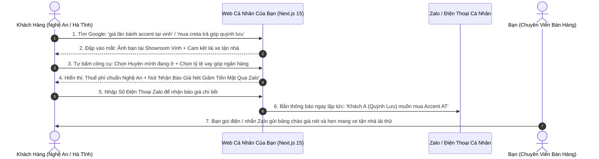

# 🚀 Product & Concept Charter: Cỗ Máy Hút Khách & Chốt SĐT Cho Sale Ô Tô Hyundai Nghệ An

> **Trạng thái:** APPROVED / READY FOR EXECUTION  
> **Chân dung Chủ sở hữu:** Tư vấn Bán hàng (TVBH) chuyên nghiệp tại **Hyundai Vinh (Nghệ An)**  
> **Mục tiêu Tối thượng:** Thu hút đúng khách có nhu cầu mua xe thật tại Nghệ An & Hà Tĩnh $\rightarrow$ Xây dựng niềm tin cá nhân $\rightarrow$ Chuyển đổi thành **Số Điện Thoại / Zalo cá nhân** để gọi chốt cọc, không bị rò rỉ khách cho người khác.  
> **Bảo hiểm An toàn:** Tuân thủ 100% quy chế giá niêm yết của Hyundai Thành Công (HTV) & Đại lý (không vi phạm, không bị phạt).  
> **Codebase:** CarDealer Monorepo (Next.js 15, PostgreSQL, `@cardealer/core`)

---

## 1. 🎯 BÓC TÁCH HẠT MẦM: TƯ DUY KHÁC BIỆT CỦA WEB SALE CÁ NHÂN

### 1.1 Điểm mù của 90% Sale Ô Tô khi tự làm website
* **Lỗi 1: Cố làm giả làm website Showroom 3S.** Khách vào thấy ảnh hãng chung chung, không biết ai là người chịu trách nhiệm, sinh tâm lý nghi ngờ (sợ cò xe lừa cọc) $\rightarrow$ Khách xem xong xách tiền ra showroom gặp sale khác ký hợp đồng!
* **Lỗi 2: Phá giá công khai trên web để hút khách.** Bị đồng nghiệp hoặc sale đại lý bạn chụp màn hình gửi Giám đốc $\rightarrow$ Bị phạt tiền, trừ thưởng, tước quyền bán hàng vì vi phạm quy chế HTV.
* **Lỗi 3: Show hết giá lăn bánh chi tiết từng đồng.** Khách chụp màn hình lấy barem giá của bạn mang đi ép sale khác bớt thêm vài triệu $\rightarrow$ Thành "tổng đài tư vấn miễn phí", tốn tiền làm web nhưng mất trắng khách.

### 1.2 Tuyên ngôn Định vị Mới (The Trusted Local Advisor)
> *"Website không phải là một showroom vô hồn, mà là **Văn phòng Tư vấn Kỹ thuật & Báo giá Cá nhân** của Bạn – Chuyên viên tư vấn chính hãng tại Hyundai Vinh. Bán CHÍNH MÌNH (Sự tận tâm, uy tín, hỗ trợ tận nhà) trước khi bán xe."*

---

## 2. 🛡️ PHƯƠNG ÁN HÓA GIẢI 3 BẪY TỬ THẦN (ADVERSARIAL DEFENSE)

| Bẫy tử thần (Từ Subagent) | Rủi ro | Giải pháp Hóa giải Độc quyền trong Thiết kế Web |
| :--- | :---: | :--- |
| **1. Bẫy vi phạm chính sách Giá Hãng (HTV)** | Bị phạt 5-20tr, sa thải | **Tuân thủ niêm yết 100% trên giao diện công khai.** Mọi khoản giảm giá tiền mặt, tặng phụ kiện được đưa vào cơ chế **"Gated Zalo"**: *"Chính sách ưu đãi đại lý thay đổi theo tuần. Bấm nhận Bảng Giá Nét gửi kín qua Zalo sau 30 giây"*. Hợp lệ 100% với thanh tra hãng. |
| **2. Bẫy khách "Dò mìn" lấy giá đi ép sale khác** | Mất công, mất khách | **Chặn rò rỉ barem giá:** Công cụ chỉ hiển thị các chi phí cứng của Nhà nước (Thuế trước bạ, biển số TP. Vinh 1tr vs Huyện 200k). Phần "Giá thanh toán thực tế sau ưu đãi" yêu cầu nhập SĐT/Zalo để nhận bản PDF chi tiết. Triệt tiêu 100% khách dò mìn! |
| **3. Bẫy mất niềm tin (Khách sợ cò xe lừa cọc)** | Khách đến showroom cọc người khác | **Đập tan nỗi sợ bằng Bằng chứng Thực tế (Radical Proof):** Show rõ ảnh chân dung bạn mặc đồng phục tại Showroom Km 3+500 Đại lộ Lê Nin; Thẻ nhân viên; Ảnh thật bàn giao xe cho khách ở Diễn Châu, Quỳnh Lưu, Yên Thành; Cam kết: *"Ký hợp đồng và nhận xe 100% tại Showroom Hyundai chính hãng"*. |

---

## 3. 🔄 HÀNH TRÌNH CHUYỂN ĐỔI SĐT (THE PERSONAL SALES CONVERSION LOOP)

---

## 4. 🪝 3 TÍNH NĂNG VŨ KHÍ GIỮ CHÂN & CHỐT SỐ ĐIỆN THOẠI

### 1. Công Cụ Dự Toán Lăn Bánh "Đúng Chất Nghệ An"
* **Độc quyền địa phương:** Tự động nhận diện phí cấp biển số:
  - **TP. Vinh:** 1.000.000 VNĐ.
  - **Các huyện Diễn Châu, Yên Thành, Quỳnh Lưu, Đô Lương, Nam Đàn...:** 200.000 VNĐ.
  - **Hà Tĩnh:** Áp dụng theo biểu phí tỉnh bạn.
* Khách bấm chọn huyện mình đang ở $\rightarrow$ thấy số liệu chính xác từng đồng $\rightarrow$ tin tưởng tuyệt đối.

### 2. Form Móc Câu: "Nhận Bảng Giá Nét & Ưu Đãi Đại Lý Qua Zalo"
* Lời dẫn: *"Chương trình giảm giá tiền mặt từ 20–50 triệu và tặng phụ kiện chính hãng được áp dụng riêng cho khách hàng liên hệ trực tiếp trong tháng này."*
* Trường thông tin tối giản: **[ Tên Bạn ]** + **[ Số Điện Thoại Zalo ]** $\rightarrow$ Bấm **[ NHẬN BÁO GIÁ QUA ZALO TRONG 30S ]**.

### 3. Cam Kết Độc Quyền: "Lái Thử Tận Nhà Miễn Phí Tại Mọi Huyện"
* Khách hàng ở huyện xa (cách Vinh 40–80km) rất ngại vào thành phố chỉ để xem xe.
* Banner nổi bật: *"Chỉ cần bạn có nhu cầu, tôi sẽ trực tiếp lái xe Accent / Creta / Tucson về tận sân nhà bạn ở Diễn Châu, Quỳnh Lưu, Yên Thành để bạn và gia đình lái thử hoàn toàn miễn phí."* $\rightarrow$ **Cú hích chuyển đổi cực mạnh!**

---

## 5. 🎯 CHIẾN LƯỢC SEO BẮN TỈA (SNIPER LOCAL SEO - KHÔNG TỐN TIỀN ADS)

Tuyệt đối không đốt tiền chạy đua từ khóa chung với đại lý mẹ. Tập trung "bắn tỉa" vào **3 cụm từ khóa có tỷ lệ mua xe cao nhất**:

1. **Cụm Dòng xe + Huyện/Thành phố:**
   - `giá lăn bánh hyundai accent tại tp vinh`
   - `mua xe hyundai creta trả góp ở diễn châu nghệ an`
   - `giá hyundai santafe 2024 tại vinh nghệ an`
2. **Cụm Nỗi đau Tài chính Địa phương:**
   - `hướng dẫn mua xe ô tô trả góp tại nghệ an không cần sao kê bảng lương`
   - `lãi suất vay mua xe hyundai ngân hàng tại nghệ an tháng này`
3. **Cụm Địa hình & Ngập nước Xứ Nghệ (Thu hút traffic thảo luận):**
   - `đường ngập nước tp vinh mùa mưa: nên chọn hyundai creta gầm cao hay accent?`

---

## 6. ✂️ KẾ HOẠCH CẮT LÁT MVP (WALKING SKELETON CHO SALE - 7 NGÀY LÊN SÓNG)

Mục tiêu: Đưa ngay 1 trang web bán hàng cá nhân lên sóng trong **7 ngày** để bắt đầu gom SĐT:

- [ ] **Lát cắt 1: Trang Profile & Showroom Anchor:**
  - Giới thiệu bản thân: Ảnh chụp tại Showroom Hyundai Vinh, vị trí TVBH chính hãng, hotline cá nhân.
  - Cam kết 3 KHÔNG: Không bán giá ảo, Không phát sinh chi phí ngoài hợp đồng, Không thu tiền cọc vào tài khoản cá nhân (100% chuyển khoản đại lý).
- [ ] **Lát cắt 2: Trang 2 Dòng Xe "Kiếm Cơm" (Hyundai Accent & Hyundai Creta):**
  - Thông số thực tế, ảnh xe thật đang có sẵn tại bãi Vinh.
  - Công cụ tính lăn bánh Vinh vs Huyện.
  - Form nhận bảng giá nét qua Zalo.
- [ ] **Lát cắt 3: Mobile Sticky Bar & Zalo Push:**
  - Nút gọi hotline 1-chạm & Nút chat Zalo dính mép dưới điện thoại.
  - Tự động đẩy thông báo Lead mới về Telegram/Zalo của bạn ngay khi khách bấm gửi số.
