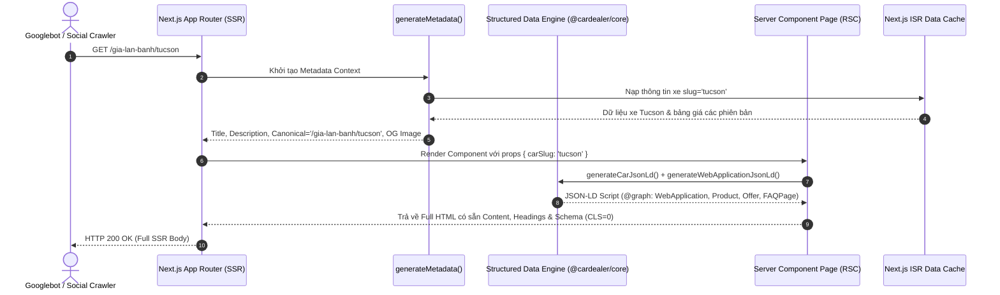
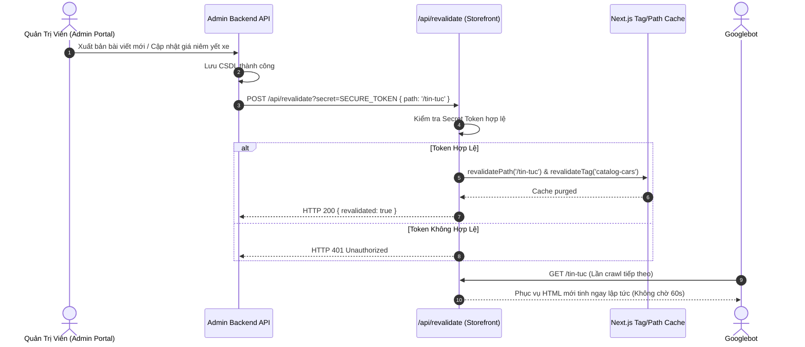
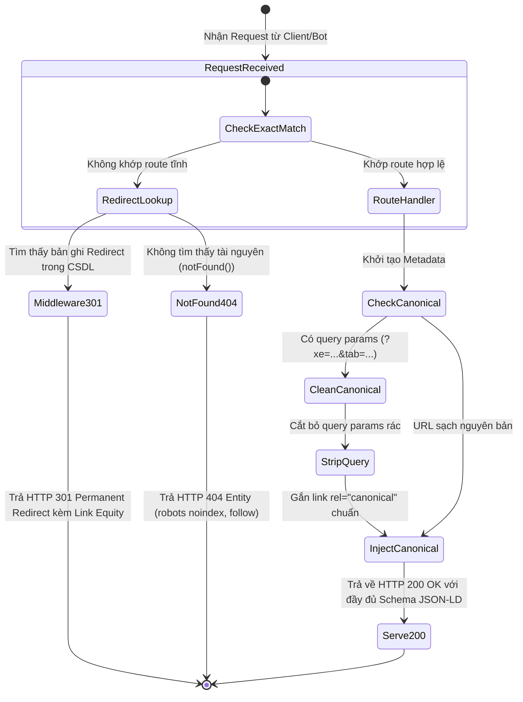

# 🌊 FLOW: Technical SEO & Organic Traffic Flow Specification

> **Module:** `seo-optimization`  
> **Phiên bản:** `v1.0.0`  
> **Tài liệu tham chiếu:** [BACKLOG.md](./BACKLOG.md) | [SOLUTION_OPTIONS.md](./SOLUTION_OPTIONS.md)

---

## 1. Sequence Diagram: Luồng Thu Thập Dữ Liệu Của Googlebot & Canonical Resolution

---

## 2. Sequence Diagram: Luồng On-Demand Cache Revalidation & Sync

---

## 3. State Machine: Vòng Đời URL & Canonical Resolution State Machine

---

## 4. Ma Trận Thất Bại Tương Tác (Interaction Failure Matrix / FMEA)

| Cặp tương tác | Kịch bản thất bại tiềm ẩn (Failure Mode) | Tác động SEO | Cơ chế phòng vệ & Phục hồi |
| :--- | :--- | :--- | :--- |
| **Googlebot ↔ Sitemap** | URL bị redirect hoặc 404 lọt vào `sitemap.xml` | GSC cảnh báo đỏ, giảm uy tín crawl budget của toàn site | Bộ lọc kiểm tra trạng thái HTTP 200 trước khi xuất bản; loại bỏ triệt để các URL redirect tạm thời (như `/tra-gop` cũ). |
| **Admin ↔ Revalidate Webhook** | Webhook revalidate timeout hoặc secret sai lệch | Cache storefront bị chậm cập nhật so với CMS | Thiết kế Fail-Open: Ghi log cảnh báo, không chặn luồng publish của Admin; hệ thống tự động fallback về Time-based ISR 60 giây. |
| **Social Crawler ↔ OG Image** | Ảnh OG không tồn tại (404) hoặc sai định dạng MIME | Mạng xã hội từ chối preview snippet hoặc hiển thị khoảng trắng | Cung cấp file ảnh tĩnh nhị phân thật (True Binary 1200x630 JPG/PNG); URL ảnh tuyệt đối có `metadataBase` bảo vệ. |
| **Người Dùng ↔ Bộ Lọc Danh Mục** | Query param rác hoặc tham số lọc quá sâu | Nguy cơ Duplicate Content hoặc lãng phí Crawl Budget | Cố định thẻ `canonical: '/xe'` trên trang danh mục bất kể query params; bộ lọc chạy in-memory client island. |
| **Client ↔ Slug Dòng Xe** | Khách truy cập slug xe đã xóa hoặc chưa xuất bản | Nguy cơ Soft-404 nếu trả về trang trắng 200 | Kích hoạt `notFound()` trả về mã trạng thái HTTP 404 thực thể với `robots: { index: false, follow: true }`. |
| **Hero Banner ↔ Thẻ H1** | Admin tắt Hero Banner sự kiện trên trang chủ | Trang chủ hoàn toàn mất thẻ `<h1>` | Cơ chế Fallback H1 tự động: Render thẻ H1 dự phòng chứa nhận diện thương hiệu Showroom khi banner tắt. |
| **Crawler ↔ Thẻ Ảnh Tin Tức** | Dùng thẻ `` thô tải ảnh kích thước lớn | Tụt điểm Core Web Vitals (LCP > 2.5s, CLS > 0.1) | Chuẩn hóa 100% sang `<Image>` Next.js có định dạng WebP/AVIF, responsive `sizes` và placeholder chống layout shift. |
