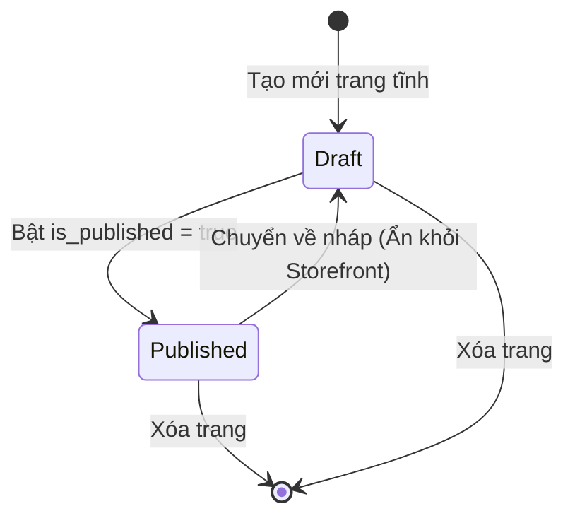
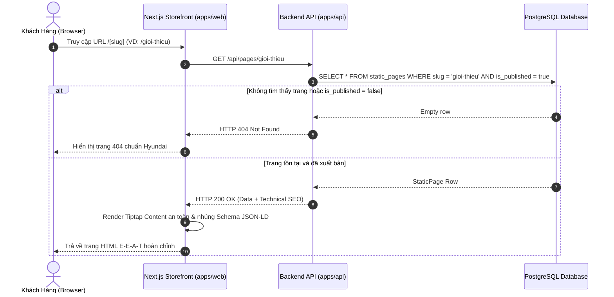
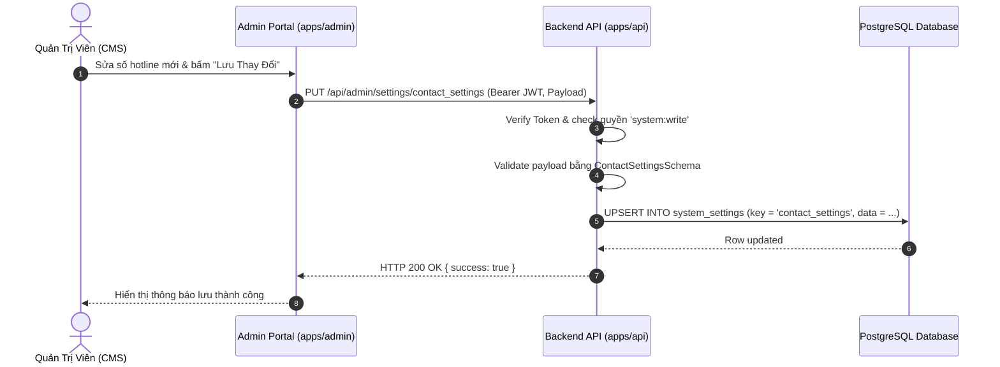

# 🔄 FLOW: Static Pages CMS & Showroom System Settings

> **Module:** `static-pages`  
> **Tài liệu tham chiếu:** [`OVERVIEW.md`](./OVERVIEW.md), [`BACKLOG.md`](./BACKLOG.md)  

---

## 1. Sơ Đồ Trạng Thái Xuất Bản Trang Tĩnh (Publishing State Machine)

---

## 2. Sequence Diagram: Hiển Thị Trang Tĩnh Động Trên Storefront

---

## 3. Sequence Diagram: Quản Trị Viên Cập Nhật Cấu Hình Showroom

