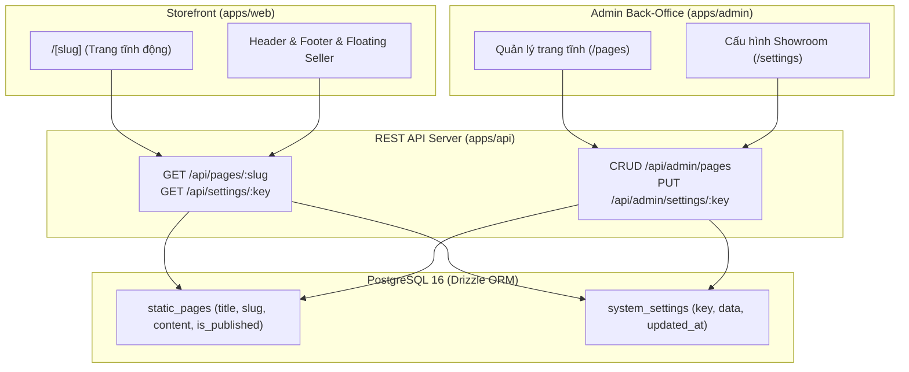

# 📄 Module Overview: Static Pages CMS & Showroom System Settings

> **Module Slug:** `static-pages`  
> **Package / App Impact:** `packages/database`, `packages/types`, `packages/core`, `apps/api`, `apps/admin`, `apps/web`  
> **Status:** Active / Production Ready  
> **Version:** 1.0.0  

---

## 1. Mục Tiêu Nghiệp Vụ (Business Objectives)
Phân hệ **Quản Trị Trang Tĩnh & Cấu Hình Showroom Toàn Cục (Static Pages CMS & Settings)** đảm bảo tính tin cậy Google E-E-A-T và nhận diện thương hiệu cho showroom ô tô Hyundai Dũng Lạc:
1. **Quản Trị Nội Dung E-E-A-T Chuẩn Mực:**
   - Soạn thảo và hiển thị các trang quan trọng: Giới thiệu đại lý (`/gioi-thieu`), Quy trình mua xe trả góp (`/quy-trinh-mua-xe`), Chính sách bảo mật (`/chinh-sach-bao-mat`), Điều khoản dịch vụ (`/dieu-khoan-dich-vu`).
   - Lưu trữ dạng Tiptap JSON AST Tree Node chống mã độc XSS và cho phép render Server-side an toàn.
2. **Technical SEO Chuyên Biệt Từng Trang:**
   - Tùy biến `metaTitle`, `metaDescription`, `canonicalUrl`, `ogImage`, `noIndex`.
   - Tự động sinh Schema JSON-LD theo loại trang (`AboutPage`, `HowTo`, `WebPage`).
3. **Cấu Hình Showroom Toàn Cục (Global System Settings):**
   - Quản lý thông tin liên hệ (`hotline`, `zalo`, `diaChi`, `email`, `googleMapsUrl`).
   - Cung cấp cho Storefront Header, Footer và Widget tư vấn viên nổi (`FloatingSeller`).

---

## 2. Lịch Sử Nâng Cấp (Evolution History)

| Phiên bản | Ngày cập nhật | Người thực hiện | Nội dung nâng cấp chính | Trạng thái |
| :---: | :---: | :---: | :--- | :---: |
| **v1.0.0** | 18/10/2026 | Fullstack CMS Team | Thiết kế bảng `static_pages` & `system_settings`, xây dựng API RESTful, trang soạn thảo Tiptap Admin và Storefront dynamic route `/[slug]` | 🟢 Active |

---

## 3. Bản Đồ Thành Phần Kiến Trúc (Architecture Map)

