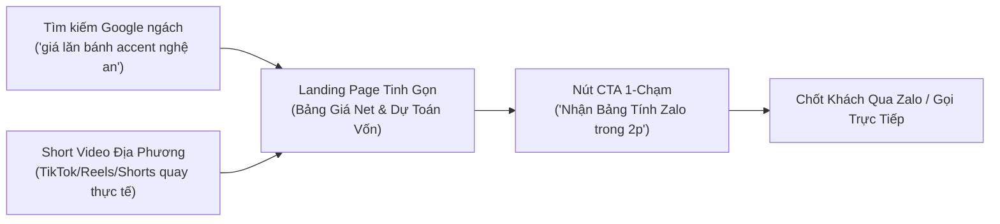

# 📄 IDEA BRIEF: CHIẾN LƯỢC TĂNG TRAFFIC TỰ NHIÊN CHO HYUNDAI NGHỆ AN - HÀ TĨNH (SOLO 0 ĐỒNG)

---

## 1. TỔNG QUAN & BỐI CẢNH (EXECUTIVE SUMMARY)

- **Mục tiêu:** Tăng lượng truy cập tự nhiên (Organic Traffic) có tỷ lệ chuyển đổi cao thành **Khách hàng tiềm năng (Lead/SĐT/Zalo)** mua xe Hyundai tại thị trường Nghệ An & Hà Tĩnh.
- **Nguồn lực thực tế:** Solo 1 người, 0 đồng ngân sách quảng cáo (No Ads), không có đội ngũ content/kỹ thuật.
- **Tập khách hàng mục tiêu (ICP):** Người dân và hộ kinh doanh tại Nghệ An (TP. Vinh, Diễn Châu, Quỳnh Lưu, Đô Lương, Yên Thành...) và Hà Tĩnh (TP. Hà Tĩnh, Kỳ Anh, Hồng Lĩnh...) chuẩn bị mua xe Hyundai (chạy gia đình hoặc dịch vụ Grab/taxi) đang so sánh giá lăn bánh và lãi suất trả góp.
- **Vấn đề cốt lõi:** Khách hàng không tin vào giá niêm yết trên web vì biết thực tế showroom luôn có giảm giá tiền mặt, quà tặng phụ kiện và chính sách trả góp riêng. Các website lớn (Oto360, web đại lý) chỉ hiển thị giá chung chung, thiếu sự tư vấn thực tế theo địa bàn huyện/xã.

---

## 2. BÓC TRẦN BẪY TỬ THẦN (ADVERSARIAL STRESS-TEST FINDINGS)

Dựa trên dữ liệu khảo cứu thực tế tại địa phương từ Subagent đối kháng:

| Hướng tiếp cận sai lầm | Cơ chế gây sập | Hậu quả cho người làm 1 mình |
| :--- | :--- | :--- |
| **Viết bài SEO dàn trải (Review, đánh giá xe, tin tức...)** | Đụng đầu trực tiếp các báo lớn (VnExpress, DanhGiaXe, Oto.com.vn) và các web đại lý mẹ (`hyundaivinh.com.vn`). | Tốn hàng trăm giờ viết bài mà không lọt top, hoặc có traffic toàn quốc nhưng không ai ở Nghệ Tĩnh mua. |
| **Tạo hàng chục trang lăn bánh theo Huyện (Cửa Lò, Diễn Châu...)** | Biểu phí trước bạ và biển số tính theo **Tỉnh** (Nghệ An 10%, Hà Tĩnh 11%). Các trang giống nhau 98%. | Bị Google phạt thuật toán **Thin Content / Scaled Content Abuse**, rớt toàn bộ thứ hạng web. |
| **Xây bộ tính toán lãi suất & lăn bánh quá phức tạp** | Web lớn đã có sẵn; khách hàng dùng xong không để lại số điện thoại (Leakage Lead). | Tốn công duy trì cập nhật lãi suất ngân hàng thay đổi hàng tháng mà không thu về lead nào. |
| **Spam link website vào các Group Facebook địa phương** | Bị Admin hội nhóm cấm (Ban), gắn cờ spam, người dùng bài xích link lạ. | Mất uy tín cá nhân, CTR nhấp link về web cực kỳ thấp (<1%). |

---

## 3. CHIẾN LƯỢC ĐỘT PHÁ: "LOCAL HIGH-TRUST MAGNET" (0 ĐỒNG CHI PHÍ)

Thay vì làm website thông tin như báo chí, bạn biến website thành **"Trạm Thu Hoạch Khách Hàng (High-Trust Capture Page)"** kết hợp 2 đòn bẩy tự nhiên:

---

## 4. BỘ KHUNG THỰC THI TINH GỌN (WALKING SKELETON - 3 BƯỚC)

### 📌 Bước 1: Tối ưu Website thành 1 Bảng Dự Toán Duy Nhất (Single Action Page)
Tập trung 100% vào **3 mẫu xe chủ lực tại Nghệ An - Hà Tĩnh**: **Accent** (Chạy dịch vụ/gia đình trẻ), **Creta** (Gầm cao đô thị), và **Santa Fe / Tucson** (Gia đình trung lưu).
- **Cấu trúc mỗi dòng xe:**
  1. *Giá niêm yết* vs. *Giá thực thu ước tính sau ưu đãi tháng này*.
  2. *Số tiền mặt tối thiểu cần có* để nhận xe (Ví dụ: Accent chỉ cần từ 110 - 130 triệu cả lăn bánh).
  3. *Số tiền trả góp hàng tháng* ước tính (Ví dụ: Từ 6,5 - 8 triệu/tháng giảm dần).
- **Nút chuyển đổi duy nhất (No Form, No Friction):**
  - Nút bấm to: **"Gửi bảng chiết tính chi tiết qua Zalo"** (mở thẳng Zalo cá nhân của bạn kèm lời chào sẵn: *"Chào em, anh muốn nhận bảng tính lăn bánh Accent tại Nghệ An"*).

### 📌 Bước 2: Bắt Trọn Từ Khóa "Long-tail" Ý Định Cao (High-Intent Local SEO)
Không SEO từ khóa chung chung như "xe hyundai". Chỉ tập trung tối ưu đúng các từ khóa người sẵn tiền chuẩn bị mua tìm kiếm:
- `giá lăn bánh accent tại vinh nghệ an`
- `mua hyundai accent trả góp tại hà tĩnh cần bao nhiêu tiền`
- `so sánh accent tiêu chuẩn và đặc biệt nghệ an`
- `khuyến mãi hyundai vinh tháng [tháng hiện tại]`

### 📌 Bước 3: Đòn Bẩy Video Ngắn Địa Phương (Local Video Parasite SEO)
Vì làm 1 mình và không có kinh phí ads, video ngắn quay bằng điện thoại là vũ khí mạnh nhất để kéo traffic tự nhiên từ Nghệ An & Hà Tĩnh:
- Mỗi khi có xe ở showroom, cầm điện thoại quay 45–60 giây:
  - *“Bác nào ở Diễn Châu, Đô Lương đang tính mua Accent chạy dịch vụ thì xem ngay video này: Tiền lăn bánh biển Nghệ An tháng này hết từng này, chuẩn bị trước 120 củ là bấm biển...”*
  - Giọng Nghệ An/Hà Tĩnh mộc mạc, chân thực mang lại độ tin cậy gấp 10 lần bài viết web hoa mỹ.
- Ghim link website hoặc số Zalo ngay trên Bio trang cá nhân và mô tả video.

---

## 5. THƯỚC ĐO THÀNH CÔNG (KPIs)
- **Không đo:** Tổng lượt view ảo từ toàn quốc.
- **Chỉ đo:** 
  1. Số lượt click vào nút **"Chat Zalo / Nhận Bảng Tính"**.
  2. Số lượng cuộc gọi / tin nhắn thực tế từ khách hàng tại khu vực Nghệ An - Hà Tĩnh mỗi tuần.
